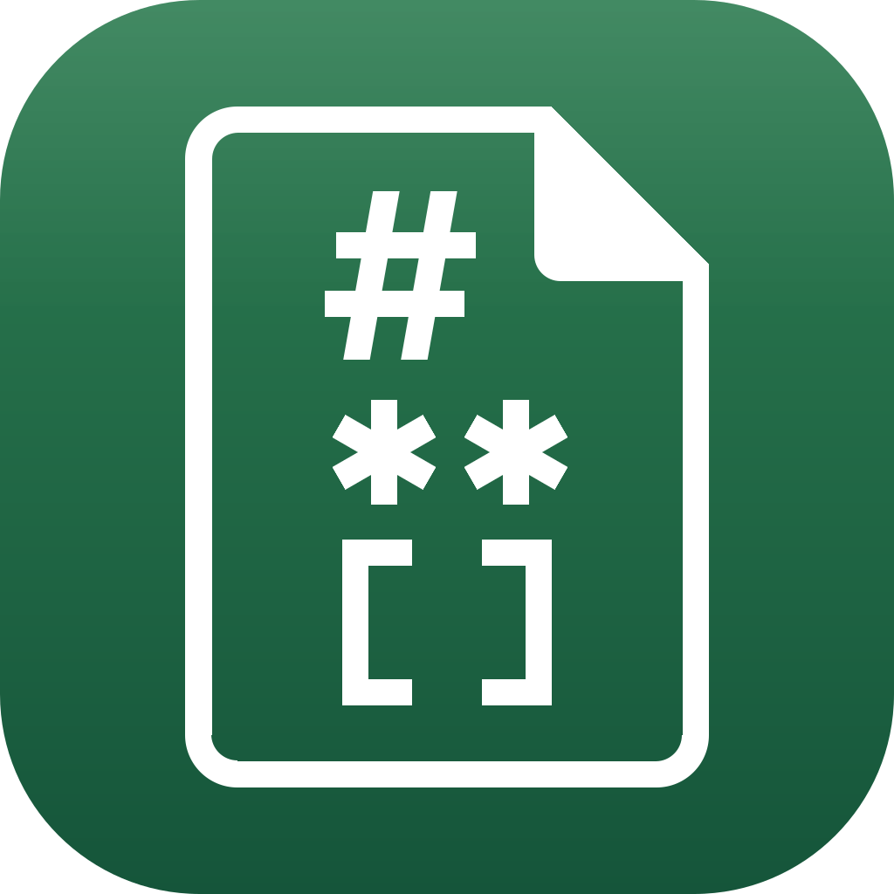

# MarkView

MarkView is a Markdown reader for macOS. You point it at a `.md` file and it
shows you the rendered document — close to how it would look on GitHub — in an
ordinary native window. It doesn't edit, it doesn't sync, and it never asks you
to sign in. It just reads.

The reason it exists is that most Markdown never reaches GitHub. Notes, design
docs, the READMEs and scratch files that command-line tools (Claude among them)
scatter across your disk — opening those in a browser tab or firing up a full
editor is more fuss than a text file is worth. MarkView is the in-between: a
window that renders the file and gets out of the way.

## Opening a file

Double-click a `.md` in Finder, drop it on the app icon, or use **File ▸ Open**
(`⌘O`). Recently opened files live under **File ▸ Open Recent**.

Each document gets its own window. Open the same file again and MarkView brings
the existing window forward instead of making a second copy — so the path you're
reading and the window you're looking at stay one and the same.

## Live reload

Leave a document open while something else writes to it and the rendered view
updates on its own. Your scroll position is kept, so watching a file change —
a build log, a doc you're editing in another app, output a tool is still
producing — doesn't bounce you back to the top every time.

## Comparing versions

This is the part MarkView leans on. **View ▸ Compare with File…** (`⇧⌘D`) puts
the current document next to another one and marks what changed between the two
— a paragraph added here, a line dropped there. Good for an earlier draft
against a later one, or two copies of the same generated file that should be
almost-but-not-quite identical. Both sides keep live-reloading, so if either
file changes on disk the diff redraws itself. MarkView also remembers the
comparisons you had open and offers to bring them back next time.

For a `.md` file that lives in a git repository, it goes further. A revision
menu appears in the title bar listing the working copy and every commit that
touched the file — short hash and subject line. Pick one and the window shows
the file as it stood at that commit; the arrow keys walk backward and forward
through its history. Switch into comparison and you get two of those menus,
labelled **L** and **R**, so you can diff any version against any other: last
week's commit against today's working copy, or two old revisions against each
other — all without leaving the reader or dropping to the command line.

## Links that behave

Links do what a documentation reader should:

- A heading link (`#some-heading`) scrolls you there.
- A link to another local Markdown file opens that file in its own MarkView
  window.
- Anything else — a web URL, a PDF, an image — is handed to whatever app
  normally opens it.

Images work too, including ones referenced by a relative path next to the
document. Remote images load over the network; local ones are read straight off
disk.

## What it renders

GitHub Flavored Markdown, including tables, task lists, strikethrough,
autolinks, footnotes, and emoji. On top of that:

- **Code blocks** are syntax-highlighted, and each one has a button to copy its
  contents and a toggle between wrapping to the window and scrolling sideways.
- **Math** written in LaTeX renders inline and as display blocks.
- **Mermaid** fenced blocks turn into diagrams.

The whole thing follows your system appearance, so it's light in the day and
dark at night without you touching anything.

## Finding text

`⌘F` opens a find bar. `⌘G` and `⇧⌘G` step forward and backward through the
matches.

## Sizing the text

There are two independent ways to make things bigger:

- **Font size** (`⌘=` / `⌘-` / `⌘0`) scales the text the way you'd bump up a
  document's base size.
- **Zoom** (`⇧⌘=` / `⇧⌘-` / `⇧⌘0`) scales the entire page, images and all.

Both are live, and your choice sticks with the window.

## Settings

**MarkView ▸ Settings** (`⌘,`) lets you pick the body font, the code font, and
the default text size new documents open at.

Not sure what syntax MarkView understands? **Help ▸ Markdown Cheat Sheet**
(`⌘/`) opens a reference document — itself rendered in MarkView.

## Keyboard shortcuts

| Action | Shortcut |
| --- | --- |
| Open | `⌘O` |
| Reload | `⌘R` |
| Find | `⌘F` |
| Find next / previous | `⌘G` / `⇧⌘G` |
| Font size up / down / reset | `⌘=` / `⌘-` / `⌘0` |
| Zoom in / out / reset | `⇧⌘=` / `⇧⌘-` / `⇧⌘0` |
| Compare with file | `⇧⌘D` |
| Markdown cheat sheet | `⌘/` |
| Settings | `⌘,` |
