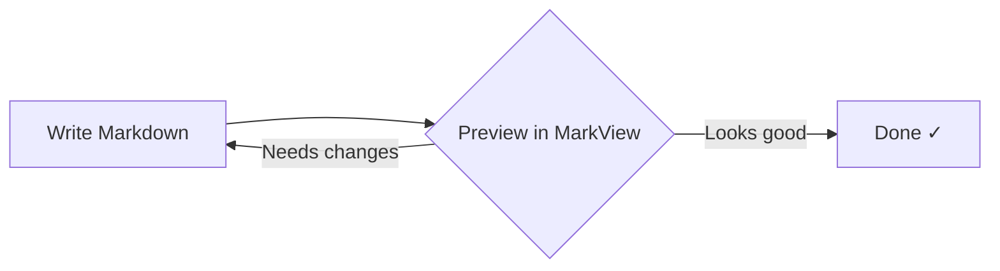
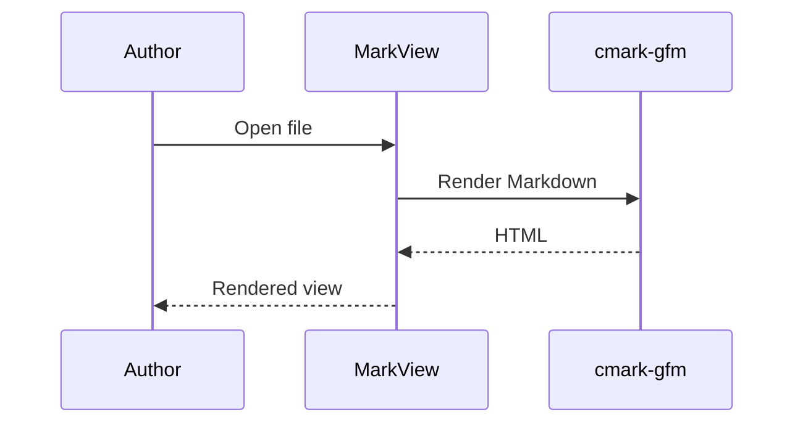

# Markdown Cheat Sheet

All formatting supported by MarkView — **GitHub Flavored Markdown** (GFM)
with KaTeX math and Mermaid diagrams.

Left column shows what you type; right column shows how it renders.

---

## Inline Formatting

| Syntax | Renders as |
|:---|:---|
| `**bold**` | **bold** |
| `*italic*` | *italic* |
| `***bold and italic***` | ***bold and italic*** |
| `~~strikethrough~~` | ~~strikethrough~~ |
| `<u>underline</u>` | <u>underline</u> |
| `<ins>underline (alt)</ins>` | <ins>underline (alt)</ins> |
| `` `inline code` `` | `inline code` |
| `<sub>sub</sub>script` | <sub>sub</sub>script |
| `<sup>super</sup>script` | <sup>super</sup>script |
| `<kbd>⌘</kbd>+<kbd>K</kbd>` | <kbd>⌘</kbd>+<kbd>K</kbd> |
| `<mark>highlight</mark>` | <mark>highlight</mark> |

---

## Headings

Use `#` symbols at the start of a line — one `#` per level:

```
# H1 — document title
## H2 — major section
### H3 — subsection
#### H4 — minor subsection
##### H5
###### H6
```

H1 and H2 automatically get a horizontal rule beneath them.
Each heading gets an anchor you can link to (see [Links](#links)).

---

## Paragraphs and Line Breaks

| Syntax | Effect |
|:---|:---|
| Blank line between text | New paragraph |
| Two spaces + Enter | Hard line break within a paragraph |
| `<br>` | Hard line break (HTML) |

---

## Links

| Syntax | Renders as |
|:---|:---|
| `[text](https://example.com)` | [text](https://example.com) |
| `[text](https://example.com "Tooltip")` | [text](https://example.com "Tooltip") |
| `[jump to section](#inline-formatting)` | [jump to section](#inline-formatting) |
| `[open sibling file](other.md)` | *(opens other.md in a new window)* |
| `<https://example.com>` | <https://example.com> |
| `user@example.com` | user@example.com |

Local `.md` links open in a new MarkView window.
External links open in your default browser.

---

## Images

| Syntax | Effect |
|:---|:---|
| `` | Displays `image.png` from the same folder |
| `` | Displays a remote image |
| `` | Image with a hover tooltip |

---

## Lists

### Unordered

```
- First item
- Second item
  - Nested item (indent with 2 spaces)
  - Another nested item
- Back at top level
```

- First item
- Second item
  - Nested item (indent with 2 spaces)
  - Another nested item
- Back at top level

### Ordered

```
1. First
2. Second
3. Third
```

1. First
2. Second
3. Third

The actual numbers don't matter — `1. 1. 1.` renders as 1, 2, 3.

### Task list

```
- [x] Completed task
- [ ] Pending task
- [x] Another completed task
```

- [x] Completed task
- [ ] Pending task
- [x] Another completed task

---

## Code

### Fenced code block

Use triple backticks with an optional language tag for syntax highlighting:

    ```swift
    func greet(_ name: String) -> String {
        "Hello, \(name)!"
    }
    ```

```swift
func greet(_ name: String) -> String {
    "Hello, \(name)!"
}
```

Popular language tags: `swift` `python` `javascript` `typescript` `bash`
`json` `yaml` `sql` `html` `css` `c` `cpp` `rust` `go` `java` `ruby`

Each code block has a **Copy** button and a **Scroll ↔ Shrink** toggle in
the top-right corner (visible on hover).

---

## Blockquotes

```
> This is a blockquote.
> It can span multiple lines.
>
> > Nested blockquotes are indented further.
```

> This is a blockquote.
> It can span multiple lines.
>
> > Nested blockquotes are indented further.

---

## Tables

```
| Left-aligned | Centered | Right-aligned |
|:-------------|:--------:|--------------:|
| Cell         | Cell     | Cell          |
| Data         | Data     | Data          |
```

| Left-aligned | Centered | Right-aligned |
|:-------------|:--------:|--------------:|
| Cell         | Cell     | Cell          |
| Data         | Data     | Data          |

Alignment is set in the separator row: `:---` left, `:---:` centre, `---:` right.

---

## Horizontal Rule

Any of these produce a horizontal line:

```
---
***
___
```

---

## Footnotes

```
Here is a claim that needs a citation.[^1]

Another claim.[^note]

[^1]: The footnote text goes here, at the bottom of the document.
[^note]: Footnotes can use arbitrary labels.
```

Here is a claim that needs a citation.[^1]

Another claim.[^note]

[^1]: The footnote text goes here, at the bottom of the document.
[^note]: Footnotes can use arbitrary labels.

---

## Math (KaTeX)

### Inline math — wrap in single `$...$`

| Syntax | Renders as |
|:---|:---|
| `$E = mc^2$` | $E = mc^2$ |
| `$\sqrt{a^2 + b^2}$` | $\sqrt{a^2 + b^2}$ |
| `$\frac{1}{2}$` | $\frac{1}{2}$ |
| `$\sum_{i=1}^{n} i = \frac{n(n+1)}{2}$` | $\sum_{i=1}^{n} i = \frac{n(n+1)}{2}$ |
| `$\alpha, \beta, \gamma, \Delta, \Omega$` | $\alpha, \beta, \gamma, \Delta, \Omega$ |

### Display math — wrap in `$$...$$` on its own lines

```
$$
\int_0^\infty e^{-x^2}\,dx = \frac{\sqrt{\pi}}{2}
$$
```

$$
\int_0^\infty e^{-x^2}\,dx = \frac{\sqrt{\pi}}{2}
$$

```
$$
\begin{pmatrix} a & b \\ c & d \end{pmatrix}
\begin{pmatrix} x \\ y \end{pmatrix}
= \begin{pmatrix} ax+by \\ cx+dy \end{pmatrix}
$$
```

$$
\begin{pmatrix} a & b \\ c & d \end{pmatrix}
\begin{pmatrix} x \\ y \end{pmatrix}
= \begin{pmatrix} ax+by \\ cx+dy \end{pmatrix}
$$

---

## Diagrams (Mermaid)

Use a fenced code block with the language tag `mermaid`.

### Flowchart

    ```mermaid
    graph LR
        A[Write Markdown] --> B{Preview in MarkView}
        B -->|Looks good| C[Done ✓]
        B -->|Needs changes| A
    ```



### Sequence diagram

    ```mermaid
    sequenceDiagram
        Author->>MarkView: Open file
        MarkView->>cmark-gfm: Render Markdown
        cmark-gfm-->>MarkView: HTML
        MarkView-->>Author: Rendered view
    ```



### Other diagram types

Mermaid supports: `graph` / `flowchart`, `sequenceDiagram`, `classDiagram`,
`stateDiagram-v2`, `erDiagram`, `gantt`, `pie`, `gitGraph`, and more.
See [mermaid.js.org](https://mermaid.js.org) for full documentation.

---

## HTML Subset

MarkView allows a GitHub-compatible set of HTML tags by default.

| Tag | Purpose | Example |
|:----|:--------|:--------|
| `<u>text</u>` | Underline | <u>underlined</u> |
| `<ins>text</ins>` | Insert / underline | <ins>inserted</ins> |
| `<del>text</del>` | Delete / strikethrough | <del>deleted</del> |
| `<sub>text</sub>` | Subscript | H<sub>2</sub>O |
| `<sup>text</sup>` | Superscript | x<sup>2</sup> |
| `<kbd>key</kbd>` | Keyboard key | <kbd>⌘</kbd><kbd>S</kbd> |
| `<mark>text</mark>` | Highlight | <mark>highlighted</mark> |
| `<br>` | Line break | Line 1<br>Line 2 |
| `<details>` / `<summary>` | Collapsible section | *(see below)* |

### Collapsible section

```
<details>
<summary>Click to expand</summary>

Hidden content goes here.
You can include **Markdown** inside.

</details>
```

<details>
<summary>Click to expand</summary>

Hidden content goes here.
You can include **Markdown** inside.

</details>

> **Unsafe HTML** (scripts, iframes, event handlers) is stripped by default.
> Enable *Allow unsafe HTML* in Settings (**⌘,**) only for fully trusted files.

---

## MarkView Shortcuts

| Action | Shortcut |
|:-------|:---------|
| Open file | ⌘O |
| Open recent | File > Open Recent |
| Increase font size | ⌘= |
| Decrease font size | ⌘− |
| Actual size | ⌘0 |
| Settings | ⌘, |
| Cheat sheet | ⌘? |
